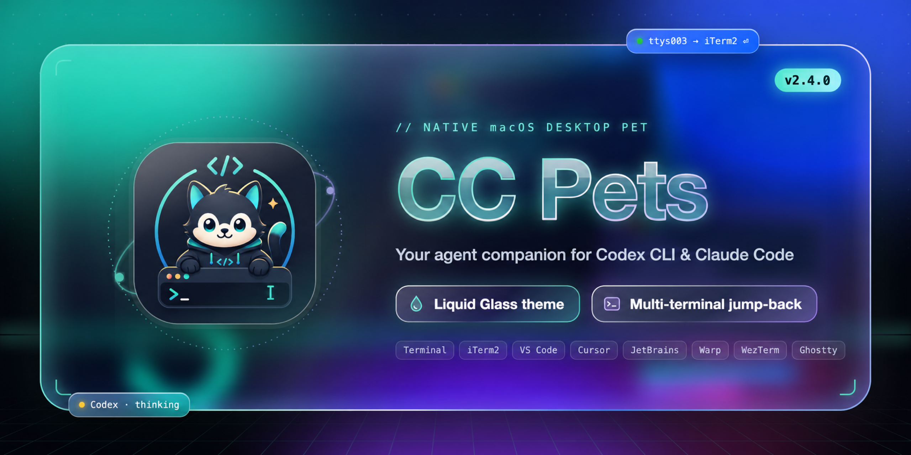
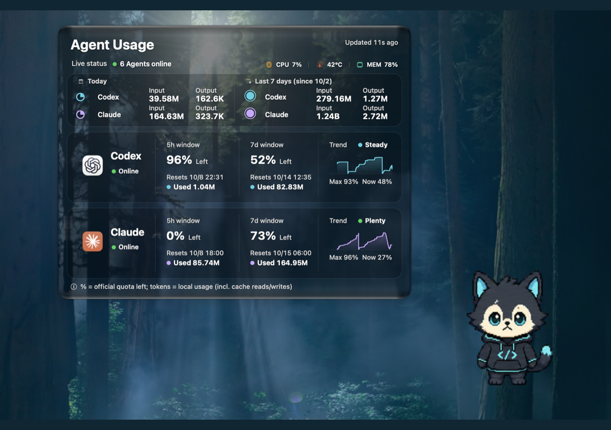
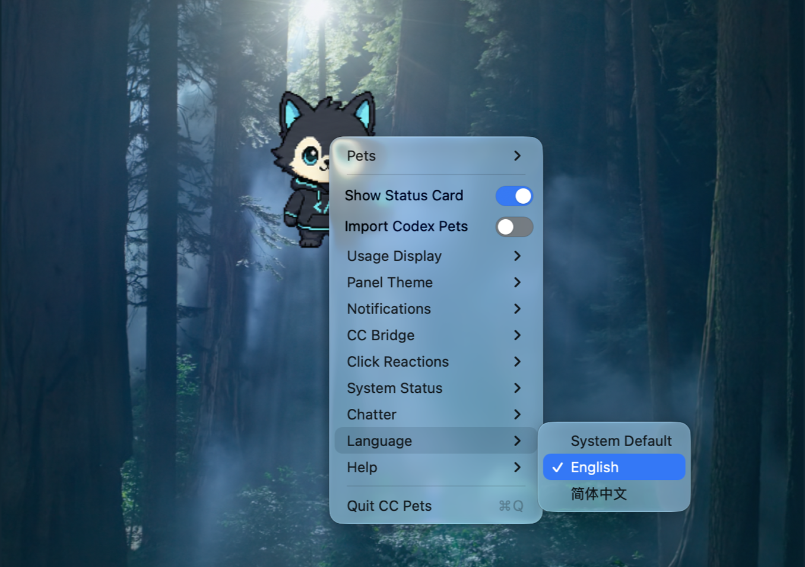
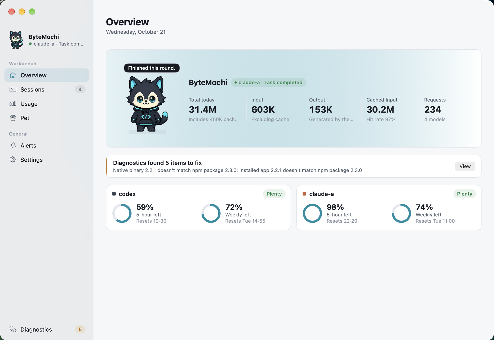
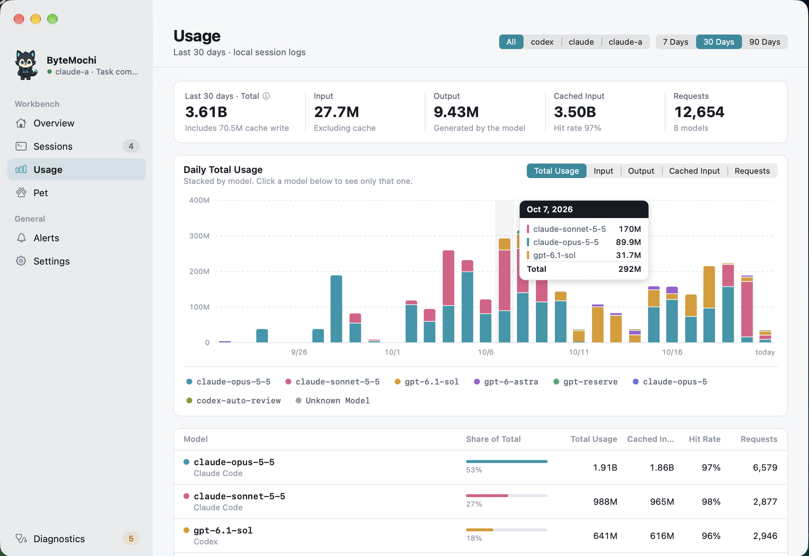

<p align="center">
  
</p>

# CC Pets

English | [简体中文](./README.zh-CN.md)

A native macOS desktop pet for Codex CLI and Claude Code CLI that needs neither
desktop app. Launch CC Pets directly, or let it appear automatically when Codex CLI
or Claude Code CLI starts. It reads five-hour and weekly quota data from the official
Codex App Server interface and Claude Code's official status line input.

> The app and CLI are available in English and Simplified Chinese (see [Language](#language)).

## What's new in v2.4.0

- **Exact terminal jumps** — select terminals in VS Code and its forks, JetBrains,
  Ghostty and iTerm2, with permissions and extension management in Settings.
- **Launch protection and CC Bridge** — optional Shadowrocket exit checks before
  wrapper launches, safer session identity matching and recoverable inbox delivery.
- **Usage and pet management** — corrected Codex token accounting, background usage,
  per-account quota reminders, refreshed appearance settings and custom pet deletion.

See the [changelog](./CHANGELOG.md) and [release notes](./docs/release-notes-v2.4.0.md) for the full list.

## Screenshots

<p align="center">
   
</p>

## Features

- Supports English and Simplified Chinese in the app and CLI, with live UI language switching.
- Offers Classic and native Liquid Glass panel themes on macOS 26 and later.
- Starts with Codex CLI or Claude Code CLI and closes after the last managed CLI exits.
- Shares one pet across multiple simultaneous Codex and Claude sessions.
- Shows five-hour and weekly remaining quota, reset times, local token totals, and seven-day trends.
- Converts reset times to the Mac's current system time zone.
- Responds to thinking, tool, approval, subagent, completion, and failure events.
- Displays a redacted glass status card with the active CLI session count.
- Returns to the terminal that triggered an event when its hook status card is clicked, including sessions started without the wrapper scripts.
- Lists up to eight recent online Agent terminal sessions from the status card icon.
- Badges the status icon with the number of sessions waiting for approval and pins those sessions to the top of the list.
- Speaks up when an Agent sits in approval or thinking longer than its threshold.
- Announces new versions through the pet with release highlights and updates from the right-click menu.
- Supports optional local quota history and macOS notifications.
- Supports third-party CLI agents through a provider event protocol.
- Includes editable global and per-pet speech.
- Offers **Chatter → Line Source → Pet-specific Lines / Default Lines**. Pet-specific lines
  override shared sections; default lines use only the editable shared speech file. The
  selection persists across pet changes and restarts, with pet-specific lines selected initially.
- Includes one original pet and can download compatible assets from PetDex.
- Opens the Main menu, a regular app window with an overview, your sessions and CC Bridge messages, token usage by model, every setting and built-in diagnostics (see [Main menu](#main-menu)).
- Uses native AppKit with no Electron runtime.

## Requirements

- macOS 13 or later
- Node.js 18 or later, for npm only: it installs and updates CC Pets, while the app and
  its `cc-pets` commands, hooks and CC Bridge run natively
- Codex CLI and/or Claude Code CLI installed and signed in
- zsh
- Xcode Command Line Tools (`xcode-select --install`)

## Installation

### Install from npm

```bash
npm install -g cc-pets@latest --allow-scripts=cc-pets
# Open a new terminal after the first installation.
codex
# or
claude
```

The `--allow-scripts=cc-pets` option allows recent npm versions to run the
package's `postinstall`. That step builds the native app, installs both hook
integrations, configures shell shims, and installs `~/Applications/CC Pets.app`.
If npm installed the package without running its scripts, initialize it manually:

```bash
cc-pets install
```

To persist the npm install-script allowlist for future installations:

```bash
npm config set allow-scripts=cc-pets --location=user
```

The allowlist only affects future installs, so reinstall the package or run
`cc-pets install` after changing it.

When launched through `codex-with-pet` or `claude-with-pet`, CC Pets captures the
terminal identity before the agent starts, which is the most precise source. A
session started directly — plain `codex` / `claude`, or a terminal window opened
before the shims were installed — falls back to the kernel: the controlling
terminal and the host terminal application are resolved from the process tree, so
its status cards are clickable as well. Such a session writes no pid file, so it
stays in the recent-session list while its hooks keep emitting events and leaves
the list after 60 idle seconds.

Every hook status card is clickable. The circular status icon lists up to eight
recent online Agent terminal sessions. Terminal.app and iTerm2 are selected
precisely by TTY; Ghostty 1.4+ also selects the exact tab and split. VS Code and
JetBrains IDEs use their bundled extensions for exact terminal selection. Without
an extension, or for Warp, WezTerm and older Ghostty versions, the owning app is
brought forward. macOS may request Automation permission for Terminal.app, iTerm2
and Ghostty. Manage permissions and extensions in Settings → Terminal Jump.

### Install from source

```bash
git clone https://github.com/Sunnyshinnny776/cc-pets.git
cd cc-pets
npm install -g . --ignore-scripts
cc-pets install
# Open a new terminal after the first installation.
codex
# or
claude
```

CC Pets installs `cc-pets`, `codex-with-pet`, and `claude-with-pet`. It creates
`codex` and `claude` shims under `~/.cc-pets/shims` and adds one marked block to
`~/.zshrc`; the real CLI binaries are not replaced. The shims also handle casing
variants on the default case-insensitive macOS filesystem.

If a real CLI is not on the current `PATH`, set its absolute path:

```bash
export CODEX_REAL_BIN=/absolute/path/to/codex
export CLAUDE_REAL_BIN=/absolute/path/to/claude
```

The wrappers pass the current terminal environment through unchanged. They do not
load or execute `.env` files.

## Multi-Account

CC Pets automatically detects and integrates the official `~/.claude` and
`~/.codex` Homes. Custom Homes such as `~/.claude-x` or `~/.codex-work` are never
scanned automatically: add them explicitly from **Main menu → Multi-Account**.
The folder name is used as the account name by default and is preserved exactly;
you can rename an account from its Manage menu on the same page. Each provider has its own
circular quota-card carousel, and the Usage page can filter local token history
by account.

Pet Hooks and usage collection are configured when an account is added. If CC
Bridge is already enabled, its Hooks, permissions, and MCP registration are also
configured immediately; otherwise they are added automatically when CC Bridge is
enabled later.

## Shadowrocket launch check

Enable **Main menu → Settings → Launch Protection → Shadowrocket** (off by default).
Each proxy app has its own preference; Shadowrocket is the first supported option.
CC Pets wrappers require a connected Shadowrocket VPN and a valid exit IP / region from
the service's HTTPS `/cdn-cgi/trace` endpoint before starting Claude / Codex. Failures
print a reason and return a nonzero exit code before registering a session or sending
a starting event. Disabling the option skips all network checks.

Claude defaults to `api.anthropic.com`. Codex uses the current Home's `auth.json` to select
`chatgpt.com` for ChatGPT login or `api.openai.com` for API-key login. If the mode is unknown
(for example, credentials stored only in Keychain), both exits must pass.
The response must contain valid `ip`, `loc` and matching `h` fields. `CN` and `HK` exits,
unknown regions, invalid responses, non-200 HTTP responses and connection / TLS / timeout
failures block launch. Successful probes print the domain, exit IP and region.
Each attempt has an 8-second connect timeout, a 15-second total request timeout and a
16-second process watchdog. Temporary transport failures and HTTP 502 / 503 / 504 retry
once after 1 second; VPN status is checked again before retrying. Two timed-out requests
take about 31 seconds per domain, plus VPN checks and process overhead. Blocked regions,
invalid trace responses and certificate errors are not retried. Failure messages distinguish
connection, response and process timeouts and include attempt counts and cumulative DNS /
TCP / TLS / response timings. There is no separate DNS lookup or homepage HEAD request.
Probes send no account credentials,
verify TLS certificates, ignore `~/.curlrc` and do not follow redirects.

Claude reads network environment settings from the current `CLAUDE_CONFIG_DIR/settings.json`
and terminal proxy variables, including an overridden `ANTHROPIC_BASE_URL`. Codex supports
common single-line string routing settings in `CODEX_HOME/config.toml` (`model_provider`,
`profile`, `model_providers.<id>.base_url`, `chatgpt_base_url`), `--profile` / `-p`,
`OPENAI_BASE_URL` and terminal proxy variables. Custom endpoints use their own origin's
`/cdn-cgi/trace`, with no fallback to another domain. Gateways must serve valid trace data;
this only describes the exit to the gateway, not the gateway's upstream exit.
Complex routing TOML, unsupported cloud providers, command-line configuration overrides
and project network overrides are rejected with an explanation. Enterprise-managed network
configuration is outside the supported scope. The check does not validate account access,
service-supported countries or future routing changes. It recognizes the Shadowrocket VPN
configuration, not just its running process. Original CLI binaries and desktop clients bypass it.

## CC Bridge

[CC Bridge](./CC_BRIDGE.md) is optional and off by default. It lets local Claude Code
and Codex sessions exchange messages and reserve files. Session IDs are validated;
PID fallback is accepted only for a unique live session. Ambiguous shared-host identities
are rejected rather than guessed. Codex delivery uses the recipient's Home.

Unconfirmed inbox messages are recoverable after a crash. A crash between output and
confirmation may repeat the same message ID; delivery does not mean the recipient has
read or accepted it. Turning off auto-wake also stops existing watchers from taking new
messages. Disabling Bridge blocks CLI send, rename and inbox operations; incomplete
integration removal returns an error and can be retried. See the guide for configuration
and delivery details, and the [unreleased changelog](./CHANGELOG.md#unreleased) for fixes.

## Commands

```bash
cc-pets build                 # Build the native app.
cc-pets                       # Start independently from a CLI session.
cc-pets --foreground          # Run in the foreground for debugging.
cc-pets --version             # Print the installed version.
cc-pets --status              # Print parsed Codex quota data.
cc-pets --history             # Print local quota history as JSON.
cc-pets clean                 # Remove rebuildable state and caches.
cc-pets doctor                # Check the installation and integrations, with fixes.
cc-pets open [page]           # Open the Main menu (pages: overview, sessions, usage, pet, accounts, alerts, general, diagnostics).
cc-pets paths                 # List where settings, caches and data are stored.

cc-pets pet search otter      # Search the configured asset source.
cc-pets pet add boba          # Install an asset into CC Pets' own directory.
cc-pets pet list              # List installed assets.
cc-pets pet remove boba       # Remove an installed asset.

cc-pets --help                # List all commands.
cc-pets install               # Repair or reinitialize integrations.
cc-pets bridge enable            # CC Bridge (experimental, off by default); see CC_BRIDGE.md.
cc-pets bridge status            # Show CC Bridge state and online sessions.
cc-pets bridge disable           # Remove CC Bridge integrations.
cc-pets uninstall             # Remove integrations and restore the status line.
cc-pets uninstall --purge     # Also remove the app, app data and preferences after confirmation; keeps assets and phrases in ~/.cc-pets.
cc-pets uninstall-app         # Remove only ~/Applications/CC Pets.app.

codex-with-pet                # Start the pet and enter Codex CLI.
claude-with-pet               # Start the pet and enter Claude Code CLI.
```

`package.json` is the single version source. Use `npm version patch`, `minor`, or
`major` for a future release; npm runs the test suite and the build writes the
version into the generated app's `Info.plist`. Every release also updates both
READMEs, both changelogs, the cover version, and [release status](./docs/release-status.md).
Commit the bilingual `docs/release-notes-vX.Y.Z.md` before tagging; follow the
[Release notes rules](./CONTRIBUTING.md#github-release-notes).

## Agent integration

### JetBrains IDE terminal jump

Local Reworked terminals in IntelliJ-based IDEs 2026.2 / 2026.3 (IntelliJ IDEA,
PyCharm, WebStorm, GoLand, CLion, PhpStorm, RubyMine, Rider, etc.) support exact tab selection through
the **CC Pets Terminal** plugin. Open **Settings → General → Terminal Jump** in CC Pets:
each detected IDE has its own row, and **Install** writes the bundled plugin into that IDE's
plugin folder after you confirm. Restart the IDE if it was running, then open a project to
connect automatically; no port configuration is needed. When a newer plugin ships with
CC Pets, the row offers **Update**. IDEs with a customized plugin folder (`idea.plugins.path`)
fall back to **Settings → Plugins → ⚙ → Install Plugin from Disk**. Each IDE, stable and EAP
build keeps its own plugins. Classic and remote terminals are not supported yet.
See [plugin details](plugins/jetbrains/README.md) for installation and build instructions.

### VS Code terminal jump

VS Code 1.80+ and its forks (Cursor, Windsurf, VSCodium, Insiders, etc.) jump to the exact
integrated terminal — in the panel, a split or the editor area — through the **CC Pets Terminal**
extension. In **Settings → General → Terminal Jump**, each detected app has its own row;
**Install** runs that app's own command line tool with the bundled VSIX after you confirm.
Open windows usually connect on their own; otherwise run **Developer: Reload Window**. Apps
without a command line tool fall back to **Extensions → ⋯ → Install from VSIX…**. Without the
extension, a card only brings the app forward. Remote windows (SSH, WSL, containers) are not
supported. See [extension details](plugins/vscode/README.md).

### Codex and Claude hooks

Codex Hooks and Claude Code Hooks drive the pet's agent-state animations. After a
first installation or a Codex Hook update, start Codex and run `/hooks` to review
and trust the CC Pets Hook. Codex skips untrusted user hooks.

The Claude Code integration merges into `~/.claude/settings.json` while preserving
existing `env`, `model`, `statusLine`, and hook settings. Its quota collector is
injected into the existing status line script without changing the configured
script path or output.

Third-party CLI agents can send redacted state events through standard input:

```bash
printf '%s' '{"schemaVersion":1,"provider":"MyAgent","state":"thinking"}' \
  | cc-pets provider-event
```

See [Provider protocol](./PROVIDER_PROTOCOL.md). The protocol does not accept
prompts, command text, file contents, or model output.

## Main menu

Besides the right-click menu and the hover quota panel, CC Pets has a regular app
window for your sessions, usage and settings. Open it from the right-click menu
(**Main menu**), the app menu, or the terminal:

```bash
cc-pets open               # the page you used last
cc-pets open overview
cc-pets open sessions
cc-pets open usage
cc-pets open accounts
cc-pets open general       # also: pet, accounts, alerts, diagnostics
```

<p align="center">
   
</p>

- **Sidebar** — the current pet, animated, with its status, then two groups: **Workbench**
  (Overview, Sessions, Usage, Pet, Multi-Account) and **General** (Alerts,
  Settings). Diagnostics sits at the bottom with a badge when something needs fixing.
- **Overview** — the pet and what it is doing, today's total usage with input, output, cached input and requests,
  a notice when diagnostics found problems, and compact account cards using the hover
  panel's data. Plan mode shows 5-hour and weekly quota rings, reset times and weekly pace.
  API mode shows monthly calls and total tokens, with daily call averages and input/output
  tokens underneath. Every registered account has its own card in a two-column grid.
  **Check Diagnostics** sits next to the account name only when that account has a
  diagnostic warning or failure; missing quota data alone does not trigger it.
  Existing Plan/API pills remain available per registered account, inheriting the old
  provider preference until customized. Accounts identified as API authentication are
  fixed to API usage and cannot switch; subscription accounts can still choose either
  display. Unknown authentication keeps manual switching available. Detection runs in the
  background without retaining keys or authentication command output.
- **Sessions** — the Agent sessions online right now (sessions waiting for
  approval first, each with **Go to Terminal**) and CC Bridge traffic: messages waiting in
  an inbox and recent deliveries. Only who sent what to whom is shown, never the message.
- **Usage** — local Claude Code and Codex token usage for the last 7, 30 or 90 days. The same
  five numbers as the overview lead the page: total usage (input + cache write + output +
  cached input + background usage), input, output, cached input with its hit rate, and requests. Background usage from local Codex SQLite logs contributes to the total only, without an inferred token breakdown. The daily bar
  chart stacks models in fixed colors and can switch between those five measures; click a model in the legend or the table to see only that
  model, and hover a bar for that day's numbers. Everything is counted from local session
  logs; nothing is sent anywhere. A per-day archive keeps history after Claude Code prunes
  old transcripts.
- **Multi-Account** — add Claude / Codex Homes, view paths and integration status, and manage repairs, names, relocation and removal of custom Home integrations.
- **Pet / Alerts / Settings** — every pet setting, split into three short pages (Pet:
  picker, deletion of unselected custom pets with confirmation, size, chatter, click reactions and Codex import; Alerts: notifications, the status
  card and system status; Settings: language, panel appearance and the pet sprites folder), plus finer controls such as the click-reaction thresholds and a
  continuous glass dimming slider (the menu keeps its four presets). Changes apply to the
  desktop pet immediately, and changes made in the menu show up here. Options that rewrite
  Claude Code / Codex configuration (enabling CC Bridge, auto-approve) stay in the
  right-click menu. The right-click menu keeps only the everyday items: Pets, Pet Size,
  Show Status Card, Usage Display, Panel Theme and CC Bridge.
- **Diagnostics** — the same checks as `cc-pets doctor`, problems first: each with its area,
  the suggested fix command and a copy button. Passing checks fold into one line. The PATH
  order check only points you to `cc-pets doctor` in a terminal, since the pet's own PATH
  isn't your terminal's.
  **Re-check** and **Copy Report** (paths are shown as `~`, so it is safe to paste into an
  issue). Registered accounts' Hooks and Claude status line issues offer **Auto-fix** and
  **Fix All**. Configuration and affected scripts are backed up before changes, then checks
  run again automatically. The page shows backup locations and any failures; each backup's
  `manifest.json` records original paths, permissions and backup files. Other issues retain
  their manual commands. Plain `cc-pets doctor` remains read-only.

The window is created when you open it and released when you close it, and nothing runs in
the background while it is closed. The Dock icon and menu bar appear only while it is open;
clicking the Dock icon brings a minimized window back.

## Pet interaction

| Interaction | Response |
| --- | --- |
| Hover over the head | Head interaction animation |
| Hover over the pocket | Pocket animation and quota panel |
| Hover over the feet | Foot interaction animation |
| Hover on either body side | Directional interaction animation |
| Click | Playful response animation |
| Drag left or right | Directional drag animation |
| Right-click | Pets, size, status card, usage display, panel theme, CC Bridge, Help, open the window, and quit |

**Pet Size** in the right-click menu offers a 50%–200% slider with a live percentage
and **Reset Size** to return to 100%. The pet scales around its feet, and its size
persists across pet changes and restarts.
Hook status cards and speech bubbles shrink with the pet below 100%, including
their text, icons, and click targets. At 100% and above they keep their original size.

The **Panel theme** submenu offers **Classic** and **Liquid Glass**. Classic is the
default. Changes apply immediately to the quota panel, status card, and speech
bubble, and persist across restarts. Liquid Glass uses native system glass and is
available on macOS 26 and later only. Building native glass support requires the
macOS 26 SDK or later. The same submenu has a **Glass dimming** setting for the quota
panel, status card, and speech bubble: Clear (0%), Light (25%), Standard (50%), or Legible (100%). Lower levels
look more transparent; higher levels keep text readable over light backgrounds.

### Language

The **Language** option on the window's **Settings** page offers **System Default** plus every bundled language,
currently **English** and **简体中文**. System Default follows the first supported
entry in macOS's preferred languages and falls back to English. Menus and panels switch right away; system
buttons in dialogs follow after the next launch. The choice is written to
`~/.cc-pets/language`, so `cc-pets` commands, hooks, and CC Bridge messages use the
same language; set `CC_PETS_LANGUAGE=en` or `zh-Hans` to override it for one
command. If you never edited `~/.cc-pets/speech.txt`, it switches to the default
lines of the new language; edited lines are left alone. To contribute another
language, see [Adding a language](./CONTRIBUTING.md#adding-a-language).

The pet switcher scans only built-in assets and `~/.cc-pets/pets/`. It does not
scan `~/.petdex/pets/` or `~/.codex/pets/`. To use assets installed by Codex,
enable **Import Codex Pets** on the window's **Pet** page; CC Pets copies valid
assets into its own directory without overwriting names already present.

External assets use their directory name in the menu. The app caches the list and
rescans when the modification time of `~/.cc-pets/pets/` changes, so CLI add/remove
operations do not require a restart or rebuild.

CC Pets supports the Codex `spriteVersionNumber` layouts:

- v1 or a missing version: `1536×1872`, an `8×9` grid
- v2: `1536×2288`, an `8×11` grid
- cell size: `192×208`

The first nine rows contain idle, right drag, left drag, right-side interaction,
head, pocket, feet, click, and left-side interaction animations. The two v2 rows
add 16-direction mouse tracking while idle.

## Quota and local usage data

Codex quota data comes from the official Codex App Server interface. CC Pets starts
the installed Codex CLI as `codex app-server --stdio`, reads the current windows with
`account/rateLimits/read`, and follows `account/rateLimits/updated` notifications. The
server-side values replace the rate-limit snapshots recorded in local `token_count`
events under `~/.codex/sessions`; a local snapshot is used only when it is newer than
the last server value. A `window_minutes` value of `300` is the five-hour window and
`10080` is the weekly window. CC Pets displays remaining percentage and does not
substitute expired history when a current window is unavailable.

Claude quota data comes from `rate_limits.five_hour` and
`rate_limits.seven_day` in Claude Code's official status line input. These values
are available for Claude.ai Pro/Max subscriptions after the session's first API
response. Missing values display as `--`.

Local token counts are usage observations, not subscription quota. Codex counts
come from local session events. Claude counts come from assistant usage records
under `~/.claude/projects`, aligned to the server reset window and deduplicated
across resume, fork, and compaction copies.

The persistent app reads `~/.codex` and `~/.claude` by default instead of inheriting
session-specific `CODEX_HOME` or `CLAUDE_CONFIG_DIR` values. Advanced users can
override these with `CC_PETS_CODEX_HOME` and `CC_PETS_CLAUDE_CONFIG_DIR`.

Local seven-day quota history is disabled by default. When enabled, it is stored
only at `~/Library/Application Support/CC Pets/quota-history.json`, retains seven
days, and records at most once every 15 minutes.

In API usage mode, the monthly token trend shows today's usage and recorded days on
separate lines; hover over it for the selected account's peak usage. Codex exhaustion
markers expire five minutes after sampling, including when recovered from cache.

## Speech

Low-quota reminders track subscription accounts independently at 20%, 10% and 5%
remaining, name the triggering account, and queue during cooldown. Initial samples,
expired windows and API-usage accounts do not trigger reminders. General quota
placeholders use the subscription account with the least remaining quota.

The pet's speech comes from `~/.cc-pets/speech.txt`. Open **Chatter → Edit Lines…**
on the window's **Pet** page to edit, validate, preview, or restore it. Lines are grouped
under stable situation tags such as `[idle]`, `[done]`, and `[state_thinking]`.
Each line is limited to 30 characters if it contains Chinese, Japanese, or Korean
text, and to 40 characters otherwise.

Supported live placeholders are `{quota5h}`, `{resetTime}`, `{toolName}`,
`{sessionMin}`, `{failCount}`, and `{hour}`. A line is skipped if one of its values
is unavailable.

Per-pet overrides live at `~/.cc-pets/speech/<pet-name>.txt` (the built-in asset
uses `builtin-ByteMochi.txt`). A missing section falls back to global speech; a present
section replaces that global section; an empty present section keeps the pet silent
for that situation.

The four speech-frequency presets coordinate an hourly budget, cooldown, idle
threshold, and probability. Speech stays silent while an agent is actively working.
Advanced debugging values use the existing app preferences domain:

```bash
defaults write com.universewang.cc-pets CCPetsSpeechFrequency -string chatty
defaults write com.universewang.cc-pets CCPetsSpeechCooldown -float 0
defaults write com.universewang.cc-pets CCPetsSpeechHourlyBudget -int 100
defaults write com.universewang.cc-pets CCPetsBoredomScale -float 0.1
defaults write com.universewang.cc-pets CCPetsSpeechDebugTag -string quota_low
defaults delete com.universewang.cc-pets CCPetsSpeechCooldown
```

`com.universewang.cc-pets` is the existing technical bundle/preferences identifier.

## Pet assets

This project does not operate an asset registry. The repository and npm package
contain one original built-in asset, ByteMochi (`ByteMochi.webp`), distributed under the
MIT License. All other assets are downloaded by the user to
`~/.cc-pets/pets/<name>/` and are not part of this repository or npm package.

The `cc-pets pet` command consumes PetDex's public manifest at
`https://petdex.dev/api/manifest` and accepts downloads only from allowlisted
`assets.petdex.dev` URLs. CC Pets downloads and renders those files locally; their
licenses, copyrights, and terms remain with their respective authors and platforms.

```bash
cc-pets pet search otter
cc-pets pet add boba otterumells
cc-pets pet add petdex:boba --as boba-petdex
cc-pets pet list
cc-pets pet remove boba
cc-pets pet source
cc-pets pet dir
```

The source and installation record is stored separately in `.source.json`; upstream
`pet.json` remains unchanged. A conflicting local name is never overwritten. The
`--as` option accepts localized names but rejects path separators, whitespace, and
consecutive `..` sequences.

### Importing Codex assets

CC Pets never renders directly from `~/.codex/pets/`. Enable **Import Codex Pets** on the
window's **Pet** page to copy assets containing `spritesheet.webp` or `spritesheet.png` into
`~/.cc-pets/pets/`. Existing names are skipped, imports are idempotent, and disabling
the option does not delete previously copied files.

PetDex's own CLI installs to `~/.petdex/pets/`, which CC Pets does not scan. Use
`cc-pets pet add` when you want an asset installed into CC Pets' own directory.

Set `CC_PETS_PETS_DIR` to use another asset directory. Apps started through `open`
do not inherit shell variables; use `cc-pets --foreground` or `launchctl setenv` if
the native app also needs the override.

See [Third-party notices](./THIRD_PARTY_NOTICES.md) before using or redistributing
external assets.

## Privacy

- Optional Shadowrocket launch protection (off by default) checks the local VPN state and sends HTTPS requests to the configured service’s `/cdn-cgi/trace` endpoint. The endpoint sees the connection’s exit IP; probes send no account credentials, verify TLS and do not follow redirects. See [Shadowrocket launch check](#shadowrocket-launch-check) for routing and support limits.
- Token accounting also reads local Codex SQLite logs and thread metadata, and keeps derived usage totals and incremental-read cursors in local caches; it does not upload those logs.
- Installed terminal extensions listen only on `127.0.0.1` and authenticate local requests. They store instance metadata and a local access token in `~/Library/Application Support/CC Pets/ide-instances/` with owner-only permissions. Extension installation writes to the selected IDE’s plugin/extension directory after confirmation; scripted terminal jumps require macOS Automation permission.
- Codex quota is read through the official Codex App Server started from your installed Codex CLI with its existing sign-in; Claude quota comes from the status line input Claude Code passes locally. Token counts are read from local Codex and Claude Code files.
- To tell API accounts from subscription accounts, CC Pets reads the authentication settings in each registered Home (Claude `settings.json`; Codex `auth.json` and `config.toml`) and may run that Home's `claude auth status` / `codex login status` locally. Only the resulting mode is kept, in memory; keys, emails and command output are not stored.
- Diagnostics repairs back up the affected configuration files and scripts to `~/Library/Application Support/CC Pets/diagnostic-backups/` (owner-only) before changing them; the backups stay on this Mac.
- Hooks write only redacted state events and quota cache files to the current user's temporary directory.
- Local quota history is disabled by default and retains seven days when enabled.
- Status cards and notifications show only provider, state, and redacted tool category.
- CC Pets contains no telemetry and uploads no conversations, quotas, credentials, or usage statistics.
- On launch, and when a CLI reopens the running pet, CC Pets asks the npm registry for the latest version (at most once every 10 minutes per run); only when a newer version exists does it read that version's committed release notes from the tag through raw.githubusercontent.com, then jsDelivr, with the GitHub Release API as a fallback. These requests carry no account or usage data.
- Exiting the pet or running `cc-pets uninstall` leaves no background daemon running.
- [CC Bridge](./CC_BRIDGE.md) is off by default. When enabled, messages between sessions are stored
  in the current user's temporary directory (owner-only, 24-hour expiry); it is the only feature
  that stores message content.

## Uninstall

Remove integrations while the npm package is still installed:

```bash
cc-pets uninstall
cc-pets uninstall-app
source ~/.zshrc
npm uninstall -g cc-pets
```

The uninstaller removes only CC Pets-marked hooks, shell configuration, and shims,
and restores the previous Claude status line. Other user settings and hooks remain.

## Project status and trademarks

CC Pets is a community open-source project with no affiliation, authorization, or
official partnership with OpenAI, Anthropic, PetDex, or any character rights holder.
Codex, ChatGPT, Claude, their icons, and their trademarks belong to their respective
owners. When installed application icons are unavailable, CC Pets uses bundled Claude
and Codex fallback icons with normalized sizing. Their sources and separate ownership
are documented in [Third-party notices](./THIRD_PARTY_NOTICES.md); these icons are not
covered by the project's MIT License.

## License

The code and the original ByteMochi built-in asset use the [MIT License](./LICENSE).
External assets do not automatically receive this project's license. See
[Third-party notices](./THIRD_PARTY_NOTICES.md).
